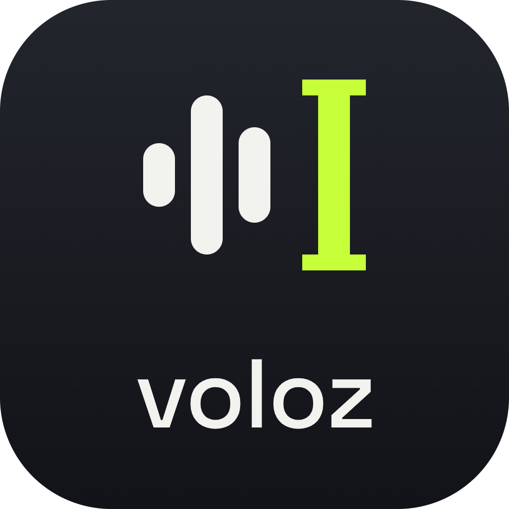

  

<h1 align="center">Voloz</h1>

  <strong>Free, open-source voice dictation for Windows, Linux and Android.</strong> 
  Hold a key, speak, let go. The text lands in the app you are using, already
  cleaned up.

  <a href="https://github.com/mvoloch/voloz/releases/latest">Download</a> ·
  <a href="#getting-started">Getting started</a> ·
  <a href="#em-português">Em português</a>

---

## What it does

Hold right Ctrl + right Shift, speak and release. Voloz transcribes what you
said, removes the "uh"s, the false starts and the self-corrections, fixes the
punctuation and pastes the result into whatever app has focus: email, chat,
a document, a code editor, a browser field.

It costs nothing to run. The default setup needs one free
[Groq](https://console.groq.com/keys) API key, which covers both steps:

| Step | Model (on Groq) |
| --- | --- |
| Transcription | `whisper-large-v3-turbo` |
| Clean-up | `openai/gpt-oss-120b` |

Groq's free tier allowed about 1,000 clean-ups a day when we checked
(October 2026; Groq sets and changes these limits). If you add an Anthropic
API key, which is optional and paid, the clean-up moves to Claude Haiku,
which stays closer to your own words. Transcription stays on Groq.

Speed: with Groq transcription and Claude Haiku clean-up we measured a
median of 1.8 s from releasing the key to having the text (8 runs). Running
the same kind of models locally on a laptop CPU took 15–31 s for 24 s of
speech, which is why the Lite edition is cloud-only.

## Platforms

| Platform | Status | File |
| --- | --- | --- |
| Windows 10/11 (x64) | Lite 0.8.18 | `Voloz_0.8.18_x64-setup.exe` (or `.msi`) |
| Ubuntu, Debian, Mint | Lite 0.8.18 | `Voloz_0.8.18_amd64.deb` |
| Fedora | Lite 0.8.18 | `Voloz-0.8.18-1.x86_64.rpm` |
| Arch, Manjaro and others | Lite 0.8.18 | `Voloz_0.8.18_amd64.AppImage` |
| Android 10+ | Prototype 0.3.0 | `Voloz-android-0.3.0.apk` |
| macOS, iOS | Not available | |

All files are on the [Releases](https://github.com/mvoloch/voloz/releases)
page.

## Before you install

- **Your audio goes to Groq.** It travels straight from your device to Groq
  (and to Anthropic, if you add that key) with your own key. There is no
  Voloz server in between. Your keys are stored only on your device.
- **The installers are not code-signed yet.** Windows SmartScreen will warn
  you: click "More info", then "Run anyway".
- **The Android app is a prototype.** It is installed from the APK, not
  from the Play Store, and it has had much less use than the desktop app.
- **Whisper sometimes turns silence into text** (a lone "." or "Gracias.").
  If you press the key and say nothing, check what was pasted.

## Getting started

1. Download the file for your system from
   [Releases](https://github.com/mvoloch/voloz/releases/latest) and install
   it.
2. Create a free key at [console.groq.com/keys](https://console.groq.com/keys).
3. Open Voloz. The first time, it opens on "Set up Voloz": paste the key
   and click "Test and save". Voloz checks the key and sets up
   transcription and clean-up for you.
4. Hold right Ctrl + right Shift, speak and release.

On Linux, Voloz reads the push-to-talk keys and types Ctrl+V like a
keyboard, so your user must be in the `input` group. The `.deb` and `.rpm`
packages also install the rule for the virtual keyboard.

On Android, install the APK, paste your Groq key, allow the microphone and
turn on Voloz's accessibility service when the app asks. A bubble appears
next to the text field you are typing in. Tap it (or hold it) and speak.

## Developing

Project status, decisions, measurements and the roadmap are in
[VOLOZ.md](VOLOZ.md). The Android app lives in [`android/`](android/), with
its own [README](android/README.md). Voicebox's developer docs in
[`docs/`](docs/) still apply to the shared desktop codebase (backend in
Python/FastAPI, app in Tauri + React).

Issues and pull requests are welcome on this repository.

## Credits and license

Voloz is a fork of [Voicebox](https://github.com/jamiepine/voicebox) by
[Jamie Pine](https://github.com/jamiepine) and its contributors. Voloz adds
the dictation focus, the Lite edition and the Android app on top of their
work. If you like the voice studio, consider
[supporting Jamie](https://buymeacoffee.com/jamiepine).

MIT licensed, like Voicebox. See [LICENSE](LICENSE).

---

## Em português

O Voloz é ditado por voz grátis e de código aberto para Windows, Linux e
Android. Segure Ctrl + Shift da direita, fale e solte: o texto entra no app
que estiver aberto, já sem "é", sem "tipo" e com pontuação.

Para usar, você precisa de uma chave grátis da Groq
([console.groq.com/keys](https://console.groq.com/keys)). Cole a chave na
primeira tela do Voloz e pronto. O áudio vai do seu computador direto para
a Groq com a sua chave, sem passar por nenhum servidor do Voloz. Os
instaladores ainda não são assinados, então o Windows mostra um aviso:
clique em "Mais informações" e depois em "Executar assim mesmo". O app de
Android ainda é um protótipo.

Mantido por [Marcus Voloch](https://github.com/mvoloch).
