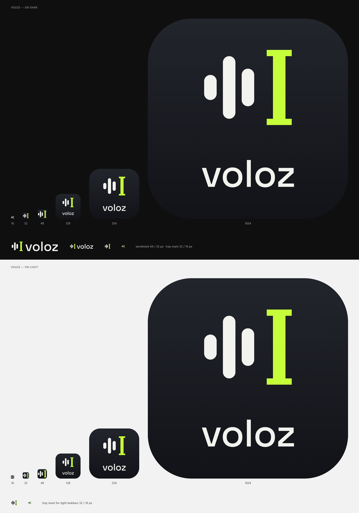

# Voloz brand assets

The Voloz mark is three voice bars followed by a text caret: speech becoming
text. The caret is as tall as the ascender of the "l" in the wordmark, so
mark and name share one baseline.

Voloz is a fork of [Voicebox](https://github.com/jamiepine/voicebox) by Jamie
Pine; this mark is new and intentionally unrelated to Voicebox's logo.

## Files

| File | Use |
| --- | --- |
| `voloz-mark.svg` | Symbol alone, light ink, transparent. Tray icon and small UI on dark surfaces. |
| `voloz-mark-on-light.svg` | Same symbol for light surfaces (e.g. a light Windows taskbar). |
| `voloz-mark-tile.svg` | Symbol on the icon tile, no text. Source for app-icon sizes of 48 px and below. |
| `voloz-icon.svg` | App icon: tile + symbol + "voloz". Source for sizes of 128 px and up. |
| `voloz-wordmark.svg` | Horizontal symbol + "voloz" for the in-app header / About page (dark UI). |
| `voloz-icon-1024.png` | 1024 px render of `voloz-icon.svg`, transparent corners. |
| `voloz-mark-1024.png` | 1024 px render of `voloz-mark-tile.svg`, transparent corners. |
| `voloz-mark-16.png`, `-32.png`, `-48.png` | Pixel-exact small icons rendered straight from the SVG at size. |
| `preview.png` | Sheet at 16, 32, 48, 128, 256 and 1024 px on dark and light. |

### Small sizes

The symbol is drawn on a 16 × 16 grid with every edge on a whole unit, so it
renders pixel-sharp at 16, 32, 48 and 64 px. Use the `voloz-mark-*.png`
files (or render the tile SVG at the target size) for 16/32/48 px icons.
Downscaling `voloz-mark-1024.png` lands on the same grid (64 px per unit),
but resampling filters such as Lanczos can add faint halos.

## Palette

| Role | Hex |
| --- | --- |
| Tile, top of gradient | `#22252C` |
| Tile, bottom of gradient | `#121318` |
| Ink (bars, wordmark) | `#F2F2EE` |
| Caret accent (lime) | `#C6FF3A` |
| Ink on light surfaces | `#16181D` |
| Caret on light surfaces | `#4D7C0F` |

## Type

The wordmark is set in **Space Grotesk Medium** (Copyright 2020 The Space
Grotesk Project Authors, [github.com/floriankarsten/space-grotesk](https://github.com/floriankarsten/space-grotesk)),
licensed under the [SIL Open Font License 1.1](https://scripts.sil.org/OFL).
All text is converted to outlines in the SVGs, so no font file ships with them.

## Editing

The SVGs are hand-written and are the masters: edit them directly and
re-render the PNGs with any SVG renderer at the listed sizes (keep the
background transparent).
